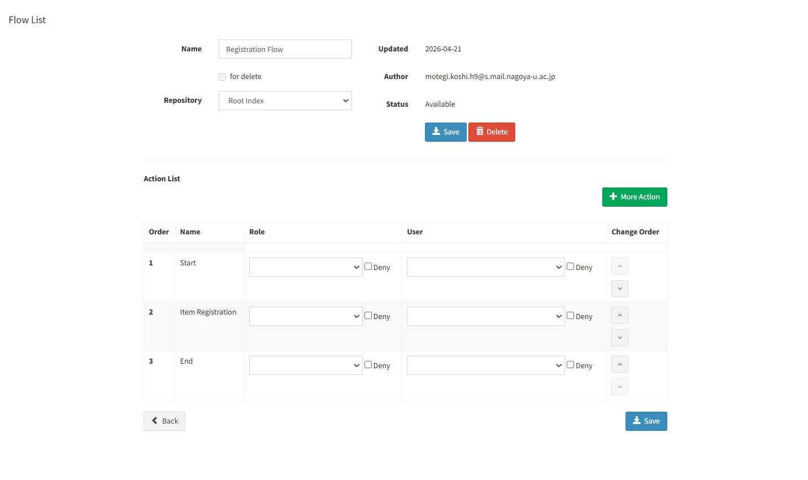
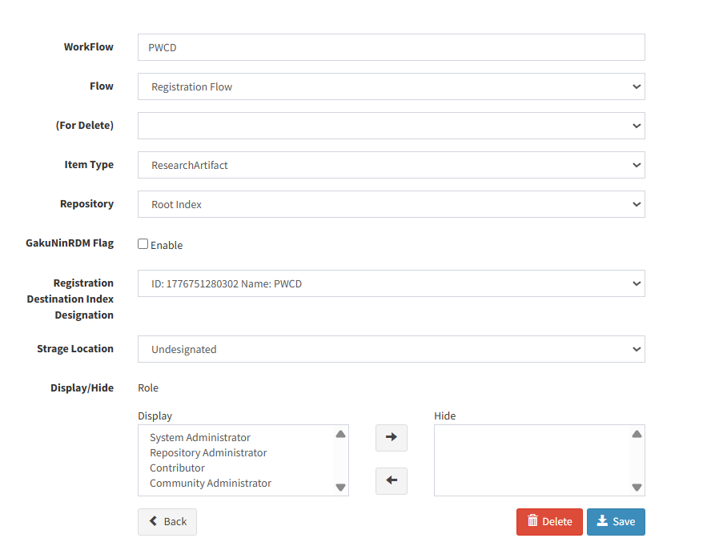

# 初期設定

ツールを使い始める前に、次の4つを行います。コマンドはリポジトリルートで実行します。

1. [依存パッケージのインストール](#依存パッケージのインストール)
2. [WEKO側の準備](#weko側の準備)
3. [設定ファイル](#設定ファイル)の編集
4. [認証情報](#認証情報)の設定

## 依存パッケージのインストール

```shell
uv sync
```

## WEKO側の準備

### Item Type

WEKOの管理画面でAdministration > Item Types > Metadataに移動し、Item Typeを設定してエクスポートします。エクスポートしたZIPは、[設定ファイル](#設定ファイル)の `item_type_export` に指定します。

同梱の [ItemType_export_sample.zip](../sample/AXIES2025/config/ItemType_export_sample.zip) はItem Typeの設定例です。このZIPをWEKOにインポートすれば、そのまま `item_type_export` に指定して使えます。

### Index Tree

WEKOの管理画面でAdministration > Index Tree > Edit Treeに移動し、登録先のIndexを作成します（詳細はWEKOの公式ドキュメントを参照してください）。

### Workflow

WEKOの管理画面でAdministration > WorkFlow > FlowList・WorkFlow Listに移動し、Workflowを設定します。設定例を次に示します。





## 設定ファイル

[config/metadata_registration.json](../config/metadata_registration.json) に、対象WEKOとItem Typeに対応する値を設定します。

```json
{
  "weko_base_url": "https://weko.example.org",
  "item_type_export": "../sample/AXIES2025/config/ItemType_export_sample.zip",
  "indexes": {
    "Example": "1234567890"
  },
  "default_index": "Example",
  "publish_date": "2025-05-27",
  "default_languages": {
    "Title": "en",
    "Title_g": "en"
  }
}
```

| キー | 必須 | 用途 |
|---|---:|---|
| `weko_base_url` | 必須 | Item Schema URLの生成とSelenium登録先の既定値 |
| `item_type_export` | 必須 | WEKOからエクスポートしたItem TypeのZIPファイルへのパス。相対パスは `metadata_registration.json` があるディレクトリを基準に解決される |
| `indexes` | 必須 | Index名をキー、IndexIDを値とする対応表 |
| `default_index` | 必須 | `--index-name` を省略した場合に使用するIndex名。`indexes` に存在する名前を指定する |
| `publish_date` | 必須 | `--publish-date` を省略した場合に使用する公開日。`2025-05-27` のようにゼロ埋めした `YYYY-MM-DD` 形式の実在する日付で指定する（それ以外は設定エラー） |
| `default_languages` | 必須 | 言語子項目（`*_language`）を持つ項目について、既定の言語コード（例: `en`）を入力列名ごとに指定するオブジェクト。行ごとの言語は、入力の `<列名>_lang` 列で上書きできる（[input-format.md](input-format.md#言語列名_lang-列)）。どのタイトル項目にも、この設定でも `<列名>_lang` 列でも言語が指定されていない場合は、生成を開始せずに停止する |
| `publish_status` | 任意 | `.PUBLISH_STATUS` に設定する公開ステータス。`public`（公開、既定値）または `private`（非公開）のみ指定可能 |
| `date_timezone` | 任意 | UTCオフセット付きの日時を日付に換算するときのタイムゾーン（IANA名）。既定値はWEKOの `BABEL_DEFAULT_TIMEZONE` と同じ `Asia/Tokyo`。未知の名前（`JST` など）は設定エラー |

Indexは、メタデータの登録先となるWEKO上のコレクションです。登録先のIndex名とIndexIDは、対象WEKOのIndex管理画面で確認してください。インポートファイル（[例](../sample/AXIES2025/ResearchArtifact(40001).tsv)）の `.IndexID[0]`・`.POS_INDEX[0]` 列や、Workflowの設定画面でも確認できます。

別のItem Typeを使う場合は、WEKOでItem Typeを設定してエクスポートし、`item_type_export` をそのZIPのパスに変更してください。

> [!NOTE]
> 同梱の [config/metadata_registration.json](../config/metadata_registration.json) は、AXIES2026のItem Type（`sample/AXIES2026/config/ItemType_export.zip`）を指しています。上の例やほかのドキュメントで「サンプル」と呼んでいるのは、AXIES2025のItem Type（`ItemType_export_sample.zip`）と [sourcedata_sample.tsv](../sample/AXIES2025/sourcedata_sample.tsv) です。AXIES2025のサンプルで試す場合は、`item_type_export` をAXIES2025のZIPに変更してください。

## 認証情報

Selenium登録を行う場合は、`.env.sample` をリポジトリルートの `.env` へコピーします。

```shell
cp .env.sample .env
```

PowerShellでも `cp` は `Copy-Item` の別名として使えます。`.env` の値を、対象WEKOのアカウントの値に変更します。

```dotenv
WEKO_EMAIL=<login-email>
WEKO_PASSWORD=<login-password>
```

`--base-dir` を指定した場合は、そのディレクトリの `.env` を読み込みます。シェルの環境変数に `WEKO_EMAIL`・`WEKO_PASSWORD` が設定されている場合は、`.env` よりそちらが優先されます。
